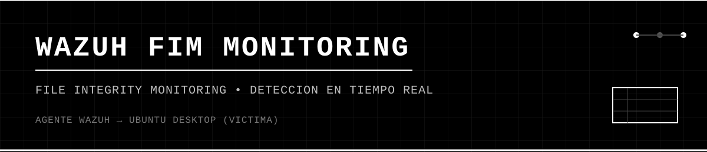
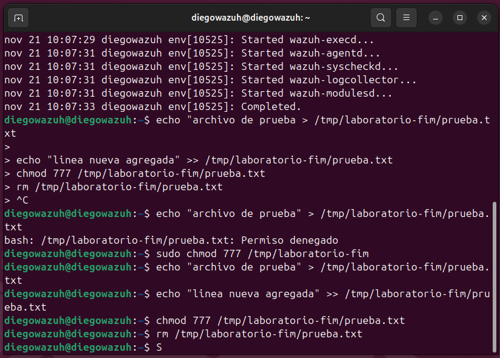
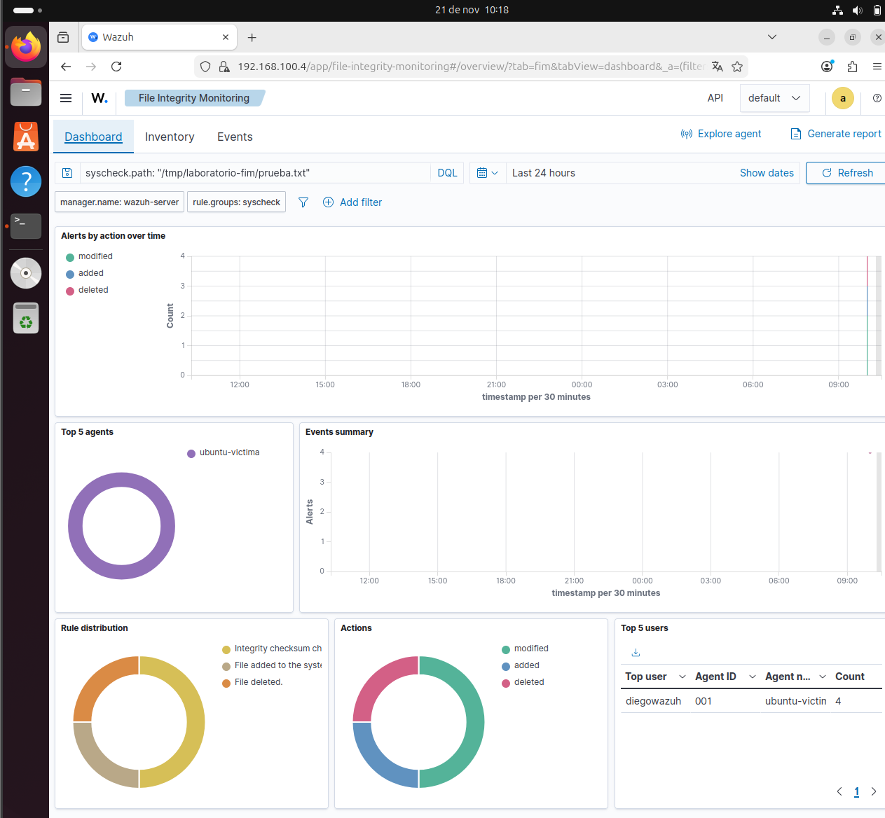
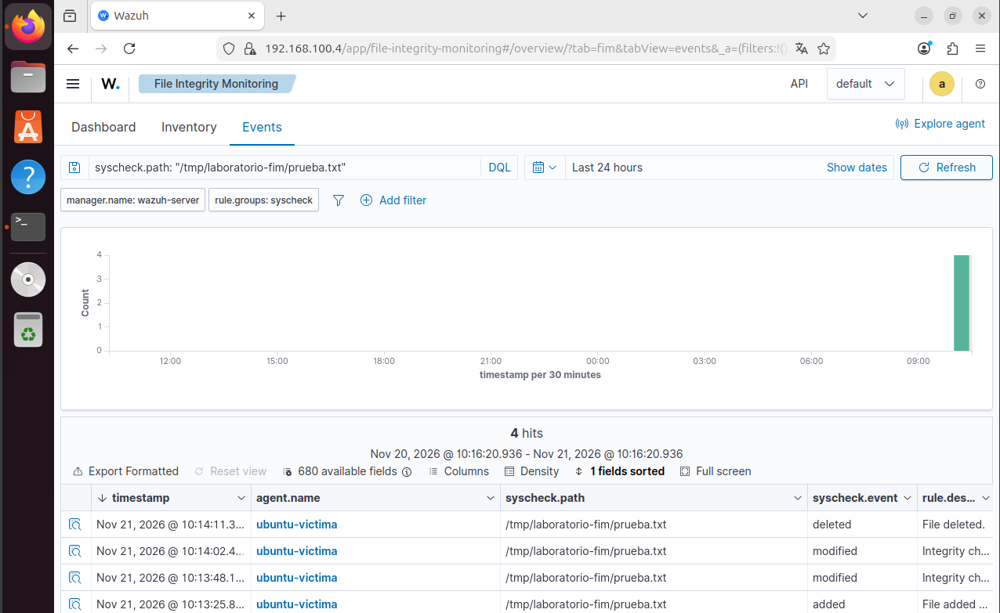

<div align="center">



<br><br>


</div>

<br>

# Monitoreo de Integridad de Archivos (FIM) con Wazuh

Laboratorio enfocado en el módulo **FIM (File Integrity Monitoring)** de Wazuh: la capacidad de vigilar en tiempo real si alguien crea, modifica, cambia permisos o elimina archivos en directorios críticos de un sistema. Es una de las 3 capacidades centrales de Wazuh (junto con detección de amenazas y de vulnerabilidades), y la que permite responder a la pregunta: **"¿alguien tocó algo que no debía?"**

Basado en la guía *"Wazuh para principiantes"* de Fatima Pérez, con configuración y pruebas propias.

<div align="center">

**[Qué es FIM](#qué-es-fim-y-por-qué-importa)** · **[Qué incluye este repo](#qué-incluye-este-repo)** · **[Configuración](#configuración-del-módulo-fim)** · **[Pruebas realizadas](#pruebas-realizadas)** · **[Resultados](#resultados-en-el-dashboard)** · **[Herramientas](#herramientas-usadas)**

</div>

---

## Qué es FIM y por qué importa

File Integrity Monitoring es el proceso de vigilar que los archivos críticos de un sistema no sean modificados sin autorización. Wazuh lo implementa a través del módulo `syscheck`, que compara el hash criptográfico y los atributos de los archivos monitoreados cada vez que detecta un cambio.

Sirve para:
- Detectar malware que modifica archivos del sistema.
- Registrar cambios en archivos de configuración sensibles.
- Identificar qué usuario realizó cada cambio (con `whodata`).
- Cumplir normativas como PCI-DSS, HIPAA y NIST que exigen auditoría de cambios.

El módulo opera en dos modos: **periódico** (escanea cada cierto intervalo, por defecto 12 horas) y **tiempo real** (`realtime`), que detecta el cambio en el momento exacto en que ocurre. Este laboratorio usa el modo **realtime**.

---

## Qué incluye este repo

| | Archivo | Contenido |
|---|---|---|
|  | [`config/syscheck-ossec.conf`](./config/syscheck-ossec.conf) | Configuración del módulo FIM (directorios monitoreados, modo realtime) |
|  | [`reporte/`](./reporte) | Reporte PDF exportado desde Wazuh |
|  | `README.md` | Explicación completa del proceso |

---

## Arquitectura

3 VMs en una NAT Network de VirtualBox. Para este módulo, el protagonista es el **agente instalado en Ubuntu Desktop** (la máquina monitoreada).

| Máquina | Rol | IP |
|---|---|---|
| Ubuntu Server | Servidor Wazuh (manager + indexer + dashboard) | 192.168.100.4 |
| Ubuntu Desktop | **Monitoreada** — agente con FIM activo | 192.168.100.5 |

---

## Configuración del módulo FIM

Se editó `/var/ossec/etc/ossec.conf` en el **agente** (Ubuntu Desktop), dentro del bloque `<syscheck>` (ver [`config/syscheck-ossec.conf`](./config/syscheck-ossec.conf)):

```xml
<directories check_all="yes" report_changes="yes" realtime="yes">/etc</directories>
<directories check_all="yes" report_changes="yes" realtime="yes">/root</directories>
<directories check_all="yes" realtime="yes">/var/log</directories>
<directories check_all="yes" report_changes="yes" realtime="yes">/tmp/laboratorio-fim</directories>
```

**Qué significa cada atributo:**
- `check_all="yes"` → verifica hash, permisos, propietario, tamaño y fecha de modificación.
- `report_changes="yes"` → muestra exactamente qué cambió dentro del archivo.
- `realtime="yes"` → detecta el cambio en el momento, usando las notificaciones del sistema operativo, en vez de esperar al próximo escaneo periódico.

Se creó una carpeta de prueba dedicada para no interferir con el sistema real:

```bash
sudo mkdir -p /tmp/laboratorio-fim
sudo chmod 777 /tmp/laboratorio-fim
```

Y se reinició el agente para aplicar los cambios:

```bash
sudo systemctl restart wazuh-agent
```

---

## Pruebas realizadas

Se provocaron 4 tipos de cambios sobre un mismo archivo, para ver cómo Wazuh detecta cada uno:

| Paso | Comando | Evento esperado |
|---|---|---|
| 1 | `echo "archivo de prueba" > /tmp/laboratorio-fim/prueba.txt` | `added` |
| 2 | `echo "linea nueva agregada" >> /tmp/laboratorio-fim/prueba.txt` | `modified` (contenido) |
| 3 | `chmod 777 /tmp/laboratorio-fim/prueba.txt` | `modified` (permisos) |
| 4 | `rm /tmp/laboratorio-fim/prueba.txt` | `deleted` |



---

## Resultados en el dashboard

En **Endpoint Security → File Integrity Monitoring → Dashboard**, filtrando por `syscheck.path: "/tmp/laboratorio-fim/prueba.txt"`, se ve el resumen visual: 4 eventos en total, repartidos entre las acciones `added`, `modified` (x2) y `deleted`, todos sobre el agente `ubuntu-victima`.



En la pestaña **Events**, el detalle fila por fila confirma las 4 acciones en orden:



**Nota:** al monitorear `/var/log` en modo realtime, Wazuh también reporta la actividad normal del sistema (escrituras constantes en `syslog` y `journal`), lo cual genera bastante "ruido" de fondo. Para aislar los eventos de la prueba fue necesario filtrar específicamente por la ruta del archivo de prueba.

**Reglas FIM relevantes:**

| ID | Nivel | Descripción |
|---|---|---|
| `554` |  | File added to the system |
| `550` |  | Integrity checksum changed (modificación) |
| `553` |  | File deleted from the system |

---

## Video de la simulación

Grabación en video del proceso completo: creación, modificación, cambio de permisos y eliminación de un archivo, visto en tiempo real junto a la detección en el dashboard de Wazuh.

<div align="center">

**[▶ Ver video](./video-fim.mp4)**

</div>

---

## Reporte Wazuh (PDF)

Reporte exportado directamente desde el dashboard de Wazuh con el resumen de alertas FIM del laboratorio.

<div align="center">

<a href="./reporte/fim-wazuh-reporte.pdf">
<br>
<b>Ver reporte PDF</b>
</a>

</div>

---

## Herramientas usadas

<div align="center">

<table>
<tr>
<td align="center" width="140">
<br>
<sub><b>VirtualBox</b></sub>
</td>
<td align="center" width="140">
<br>
<sub><b>Ubuntu</b></sub>
</td>
<td align="center" width="140">
<br>
<sub><b>Wazuh 4.14</b></sub>
</td>
</tr>
</table>

</div>

---

## Créditos

Este laboratorio se realizó siguiendo como referencia la guía *"Wazuh para principiantes"* de Fatima Pérez. Todas las configuraciones, capturas y pruebas documentadas aquí son resultado de mi propia implementación en mi entorno virtual.
